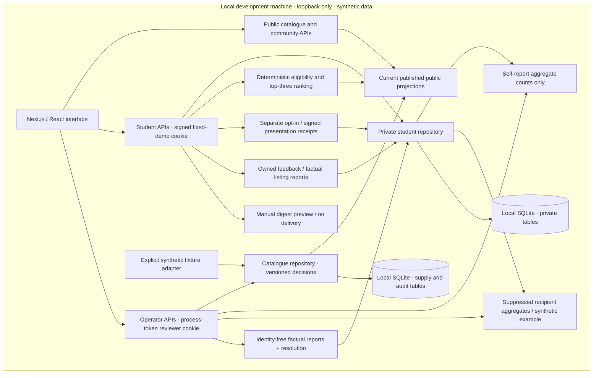
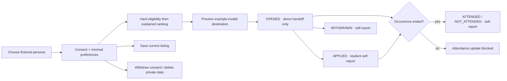
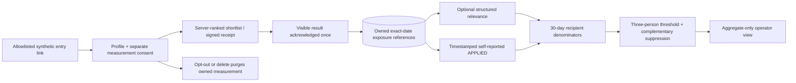
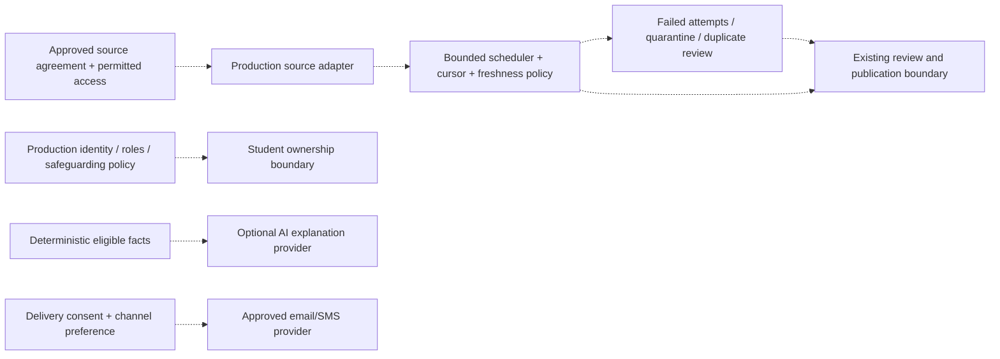

> Historical demo architecture at d3aeefd. The current durable-account/provider/deployment implementation is documented in [production-foundations.md](production-foundations.md); its activation gates replace the blanket production deferrals below.

# Full local app architecture

The original static project is preserved at the repository root. The local application is a separate Next.js app under `apps/web`. This document describes the integrated local design; the acceptance record in `docs/verification.md` identifies which checks have actually passed.

## Implemented local boundary

The two database boxes are separate table ownership boundaries in the same configured SQLite file. Student handlers resolve ownership from the signed cookie; callers cannot choose an owner in payloads. Operator catalogue handlers do not return private student profiles. The operator outcomes API returns counts and explicit evidence labels only. Factual listing reports use a separate explicit projection without owner identifiers or preferences; private fit feedback is never exposed. Resolution does not itself edit or verify a listing. New catalogue imports/edits retain immutable before/after facts; legacy unavailable snapshots are not invented. Fixed personas are selectable by anyone with local access, so this is a demonstration of role separation rather than real account security.

Each parent has 1–12 stable explicit occurrence IDs. Legacy records migrate to `primary`. Public lists return one parent card and select a qualifying current date before pagination; matching returns at most three distinct parents. Exact-date URLs never substitute siblings. Published per-date snapshots preserve historical facts. Date edits return the parent to draft, and cancelling one date does not cancel its siblings.

Public availability is recalculated on every read: a listing must be published, complete, permitted in the synthetic source record, current, not cancelled, not withdrawn, and from an unpaused source. Material edits and changed fixture imports return the record to draft. Restoring a withdrawn listing also requires a fresh review. Public projections omit internal permission and review notes.

## Student state and truthful outcomes

Activity history preserves each acknowledged version. Repeated saves and handoffs do not duplicate records for the same owner, parent and occurrence. Another date has independent activity and reminders. Pending activity follows the latest published facts for that exact date; terminal outcomes retain their original snapshot. No UI action submits an application to an organizer. No status proves attendance, verified hours, organizer approval, or school credit. One visibly historical synthetic OPENED example is added only after consent so the ended-occurrence workflow can be tried.

Preferences, saves, activity, alert settings, all reminder state, and feedback persist locally. Owner export/deletion covers these private tables. Logout clears a browser cookie; process restart rotates the student signing key and a new launcher reviewer token invalidates old reviewer cookies. Data remains and can be loaded after choosing the demo persona again. Local in-app reminders are calculated on reads, default off, and can be marked read or dismissed; there is no delivery scheduler.

## Implemented local measurement

No anonymous events, IP addresses, user agents, referrers, free text or copied preferences enter measurement. Presentation references include exact occurrence/publication, profile and rules versions. Empty results count as seekers; repeat views do not multiply recipients. Useful rate includes every shortlist recipient, including nonresponders. Next-step conversion is a linked APPLIED self-report within seven days; saves and OPENED do not qualify. Partial observation windows remain labeled and in the denominator.

Dashboard/focus reads, Matching QA and digest previews are excluded. First-touch campaign attribution starts only after consent; pausing blocks new attribution. Ninety-day retention and a 250-batch per-persona limit bound local records. The two available personas remain below the live reporting threshold. A separately computed fictional example illustrates arithmetic without entering live data. Existing operator Outcomes remains a separately labeled synthetic current-state operational view, not a longitudinal measurement funnel.

## Deferred production integrations

Dashed connections are future work. `packages/domain/providers.ts` records small provider interfaces only; no remote provider is active. A future AI explainer receives already checked facts and has no authority to alter hard eligibility. Production identity, data-retention policy, consent appropriate to the target cohort, safeguarding/incident review, source permission, deployment, backups and permitted distribution must be settled before a real student pilot. Source collection and delivery are deliberately disconnected in this build.

## Evidence map

| Concern | Source |
|---|---|
| Shared public/domain contracts and eligibility | `packages/domain/contracts.ts`, `rules.ts` |
| Student/operator app DTOs | `packages/domain/app-contracts.ts` |
| Synthetic scenarios | `packages/domain/fixtures.ts` |
| Catalogue persistence, audit, availability | `apps/web/lib/repository.ts` |
| Exact-date student migration and snapshots | `apps/web/lib/student-repository.ts`, `student-repository.test.ts` |
| Consented measurement, tokens and aggregation | `apps/web/lib/measurement-repository.ts`, `measurement-presentation.ts`, `measurement-handlers.ts` |
| Measurement DTOs | `packages/domain/measurement-contracts.ts` |
| Occurrence and measurement acceptance | `tests/occurrence-measurement-http.mjs`, `occurrence-measurement-browser.mjs` |
| One-time synthetic runtime initialization | `apps/web/lib/runtime.ts` |
| Reviewer cookie and mutation safeguards | `apps/web/lib/auth.ts`, `http.ts` |
| Student identity, consent, private state | `apps/web/lib/student-auth.ts`, `student-repository.ts`, `student-handlers.ts` |
| Full local HTTP and process-restart acceptance | `tests/full-app-http.mjs` |
| Actual desktop and phone journeys | `tests/browser-e2e.mjs` |

The blueprint's business milestones are not automatically achieved by implementing screens. Real permitted inventory, real student outcomes, organizer confirmation, channel conversion, reliable scheduled collection, and expansion readiness remain unverified.
