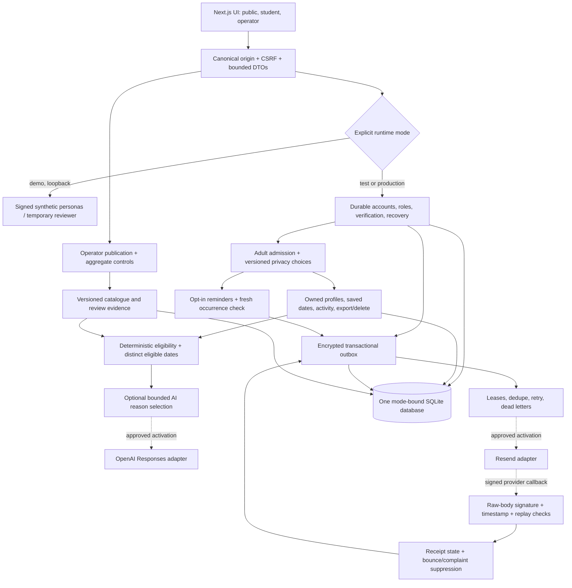
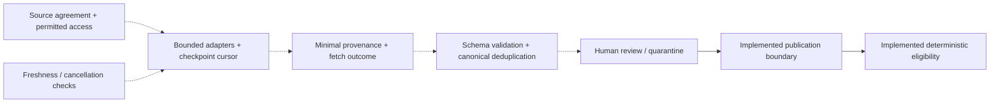

# Account, privacy, provider and deployment foundations

This phase continues `d3aeefd` on `feat/local-catalogue-matching`. It implements the locally buildable work that was previously labeled as production integration. No external provider was contacted, no account or credentials were provisioned, no real data was admitted, and no deployment or Git push was performed. Real opportunity feeds remain explicitly deferred.

## What is implemented

| Area | Implemented behavior | Main evidence files |
|---|---|---|
| Identity | Self-hosted adult account registration, email verification, password recovery/change, durable hashed sessions, logout and revocation, recent authentication, student/operator roles, bounded owner-scoped authentication limits | `apps/web/lib/account-*.ts`, `packages/domain/identity-contracts.ts` |
| Privacy | Explicit storage/adult admission, separate default-off personalization, external AI, external reminders and measurement; export and deletion; historical data retained only within its stated purpose | `privacy-store.ts`, `privacy-migration.ts`, `student-repository.ts`, account export/delete handlers |
| Safeguarding | Account admission requires adult self-attestation and profile age minimum 18. Missing facts fail eligibility. Nothing asserts verified age, organizer safety, school credit or guardian approval | `privacy-store.ts`, `packages/domain/rules.ts`, UI privacy controls |
| Notifications | Encrypted outbox, separate transactional/optional purposes, versioned opt-in, bounded cursor scan, atomic leases, dedupe/idempotency, retry/backoff, dead letters, consent/freshness checks, signed provider receipts, bounce/complaint suppression, secret-free operator view | `notification-*.ts`, `scripts/notifications-worker.mjs` |
| AI | Real OpenAI Responses HTTP adapter behind configuration and separate consent. Symbolic checked facts only; no email, identity, age, location, dates, source text or database IDs. Exact output validation; timeout/byte/request limits; deterministic fallback | `ai-provider.ts`, `ai-explanations.ts`, `ai-runtime.ts`, `ai-handlers.ts` |
| Runtime | Explicit demo/test/production boundaries, exact canonical origin, CSRF checks, production-only secure cookies, per-document script nonce CSP, no-store private responses, database mode binding | `runtime-config.ts`, `database-mode.ts`, `http.ts`, `proxy.ts` |
| Operations | Nonroot single-node container configuration, persistent SQLite/WAL, schema migration and readiness, encrypted online backups, quarantined restore, deletion/suppression reconciliation and session/token invalidation | `deploy/`, `scripts/production-*.mjs`, `docs/deployment-readiness.md` |

The AI feature selects which checked reasons to emphasize. It does not generate new facts, change eligibility, reorder the shortlist, or submit an application. Its relevance benefit has not been evaluated with students. A configured mail adapter is not proof that mail reached an inbox; provider acceptance is labeled separately from signed delivery receipts, which do not confirm reading or attendance. Bounce/complaint suppression blocks future mail and cannot be bypassed by a reminder opt-in or public recovery request.

## Current implemented system

Solid lines represent implemented local code. Dotted provider edges require owner-approved activation and live verification. Production creates an empty catalogue, no synthetic community and no example campaign. Demo fixtures cannot be imported in production. The data schema still admits only explicitly synthetic opportunity records: a real feed adapter and real-record publication contract are part of the deferred feed work.

## Explicit boundaries

- **Demo:** selectable personas; clearly synthetic records; loopback only; no live providers.
- **Test:** real account and privacy engine, synthetic users, loopback origin, explicit throwaway encryption key; no external adapter activation. Test transport injection is in constructors, never a production HTTP mailbox or auth bypass.
- **Production:** canonical HTTPS origin, private persistent database, permanent encryption key and explicit admission-policy acknowledgment required. Incomplete configuration, a demo database, interrupted migration, or quarantined restore fails closed. Production has no test/provider fallback.

The intended launch audience is unresolved: under-18 students, adults, or both. The current adult-only setting is a temporary boundary, not the approved product scope. Under-18 accounts remain blocked until an owner-approved safeguarding, consent, incident-response and data-retention policy is designed and implemented. Self-attestation does not verify age. School-credit and organizer-safety claims still require evidence and human review.

## What requires an owner decision or external action

1. Approve the intended cohort and privacy/retention/incident policies, including support and deletion ownership. The present code admits adults only. Do not set the policy acknowledgment merely to make checks pass.
2. Choose the sending identity and approve the mail provider/account, verified sender, credential storage and delivery test. Resend and the signed receipt endpoint are implemented and locally tested but not linked or activated. Receipt activation also requires an approved webhook registration and its separate signing secret; the endpoint fails closed when unconfigured.
3. Authorize use of an approved AI project/key and model, processing terms and spend controls before enabling AI. A key was detected in the local environment; it was not used, validated, copied or changed.
4. Select the deployment host, HTTPS domain, protected data/secret storage, encrypted backup retention and worker schedule. Approve deployment separately. No container image was pulled or deployed as part of this phase.
5. Approve permitted opportunity sources and bounded collection contracts when resuming the explicitly deferred feed work. Real permissions, freshness intervals, duplicate handling, source-specific parsers and operational monitoring require actual source evidence.

Those decisions affect activation, not the existence of the local implementations and testable contracts above.

## Deferred feed system

Dotted feed components are future work. Existing fixture imports demonstrate review, stale/cancelled exclusion and stable occurrences, but do not prove real collection, source permission, organizer verification or deduplication quality against real feeds.

## Distribution and measurement

The current app supports community entry pages, explicit campaign attribution after consent, shown-shortlist feedback and seven-day self-reported application measurement. Production starts with no synthetic partner or campaign. The next real pilot should obtain permission to use the channels where the approved cohort already seeks opportunities, offer useful current local supply, and measure repeat usefulness before expanding. No outreach or distribution was performed. Suppressed aggregate reporting does not establish anonymity against every possible external linkage.

## Verification and limits

See `docs/production-acceptance.md` and `docs/evidence/production-*.json` for the current integrated acceptance evidence. Earlier demo evidence remains in `docs/evidence/`; it covers only its stated demo scope. Test transports establish adapter contracts, not live provider credentials, delivery, latency or reliability. Deployment tooling tests establish local migration/backup/restore behavior, not a successful production deployment. Backup restoration must reconcile deletions and bounce/complaint suppressions made since the snapshot before traffic or workers resume.

References used for interface decisions: [OpenAI structured outputs](https://developers.openai.com/api/docs/guides/structured-outputs), installed Next.js `node_modules/next/dist/docs/01-app/02-guides/content-security-policy.md`, and the primary authentication/mail references in the account and deployment notes. Private source was not sent to these documentation services.

## Targeted security follow-up

Mailbox verification now requires the mailbox holder to choose a password and revokes all prior sessions and action tokens atomically. This prevents an attacker who pre-registers someone else's address from retaining either an unverified session or the earlier password after the real owner verifies. Verification/reset tokens are checked before password hashing and rechecked after hashing inside the commit transaction.

Authentication quotas are now scoped to an existing account and fixed action, with at most seven rows per account, exported without secret identifiers and removed with the account. Unknown email/token probes cannot consume a persistent shared login/recovery quota. Only new-address registration uses a bounded 4,096-entry pseudonymous table; a full registration table does not block existing account login/recovery. Exhausted login attempts retain the generic invalid-credential response and dummy hashing so repeated status probes do not distinguish unknown addresses.

Profile withdrawal removes notification history while retaining only the minimum expiring receipt correlation needed to honor a late complaint, including acceptance that finishes after withdrawal. No body, recipient or profile content is retained in that correlation. It expires after 30 days from dispatch preparation (original acceptance time for migrated legacy rows) and disappears on account deletion; unresolved pre-restore dispatch leases cannot be resurrected. The owner export discloses active correlation count/expiry, and the privacy screen explains the retention. See `production-acceptance.md` for regression evidence and `deployment-readiness.md` for the four live-setup decisions and residual limits.
